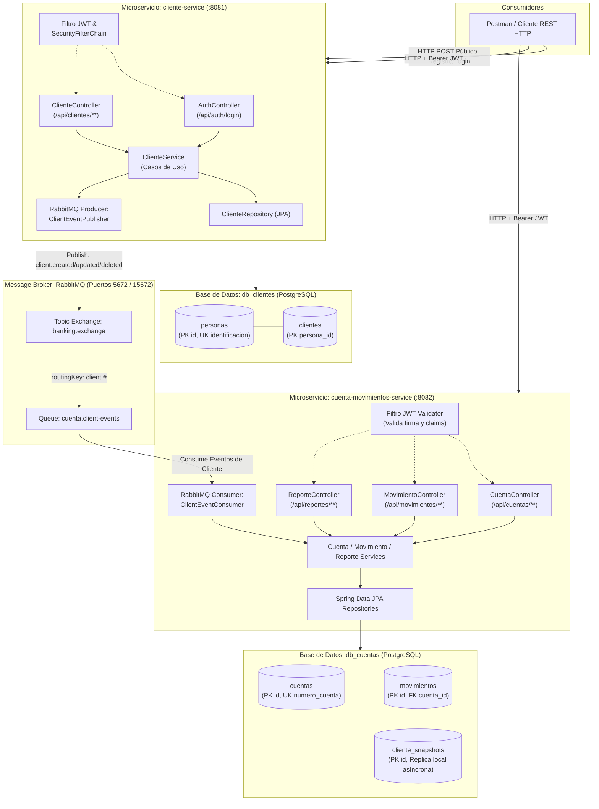

# Banking-Demo: Sistema Bancario Basado en Microservicios

[](https://www.oracle.com/java/)
[](https://spring.io/projects/spring-boot)
[](https://gradle.org/)
[](https://www.postgresql.org/)
[](https://www.rabbitmq.com/)
[](https://spockframework.org/)
[](https://cucumber.io/)
[](https://www.docker.com/)

> **Solución Integral de Prueba Técnica:** Implementación desacoplada de un sistema bancario transaccional bajo principios de **Clean Architecture**, **Domain-Driven Design (DDD)**, **Event-Driven Architecture (EDA)** y despliegue contenerizado.

URL del reporistorio: https://github.com/andresgouts/Banking-demo

---

## 1. Arquitectura y Decisiones de Diseño

El sistema está dividido en dos microservicios principales totalmente desacoplados a nivel de datos y comunicación, junto a un módulo común de seguridad:

1. **`cliente-service` (Puerto 8081):**
   - Responsable de la gestión del ciclo de vida de **Personas** y **Clientes** (CRUD - F1).
   - Servidor de autenticación y emisor de tokens criptográficos **JWT** (HMAC-SHA256).
   - Publicador de eventos asíncronos en RabbitMQ al registrar, actualizar o dar de baja lógica a clientes.
   - Base de datos independiente: `db_clientes`.

2. **`cuenta-movimientos-service` (Puerto 8082):**
   - Responsable de la gestión de **Cuentas Bancarias** (CRU - F1) y **Transacciones / Movimientos** (F2).
   - Control estricto de concurrencia mediante bloqueo pesimista (`PESSIMISTIC_WRITE`) y regla de saldo insuficiente con alerta explícita `"Saldo no disponible"` (F3).
   - Generación de reportes consolidados de estado de cuenta en formato JSON estructurado por cliente y rango de fechas (F4).
   - Consumidor de eventos de RabbitMQ que mantiene una proyección local autónoma (`cliente_snapshots`).
   - Base de datos independiente: `db_cuentas`.

3. **`common-security` (Librería Compartida):**
   - Componentes utilitarios reutilizables para firma, extracción y validación de tokens JWT (`JwtService`).
   - Filtro de seguridad (`JwtAuthenticationFilter`), excepciones y DTOs de autenticación compartidos.

### 1.1 Diagrama de Arquitectura del Sistema



### 1.2 Patrones y Principios Aplicados

* **Database-per-Service:** Máximo desacoplamiento. No existen consultas cruzadas ni llaves foráneas entre `db_clientes` y `db_cuentas`. Cada servicio es dueño de su modelo de persistencia.
* **Event-Carried State Transfer:** La sincronización de información entre microservicios se efectúa de forma eventual y asíncrona a través de eventos en RabbitMQ (`ClientEventDto`). `cuenta-movimientos-service` mantiene una tabla de proyección local (`cliente_snapshots`) para enriquecer cuentas y generar reportes sin realizar llamadas HTTP síncronas bloqueantes.
* **Clean Architecture por Capas:** Estricta separación de responsabilidades:
  - `domain`: Entidades de negocio puras, repositorios (interfaces) y excepciones de dominio.
  - `application`: Casos de uso (servicios), DTOs, mappers y puertos de salida.
  - `infrastructure`: Controladores REST, configuración de seguridad Spring Security, adaptadores JPA y de mensajería RabbitMQ.
* **Seguridad Stateless con JWT:**
  - `POST /api/clientes` (o `/clientes`) y `POST /api/auth/login` son de acceso **público** (`permitAll`) para auto-registro e inicio de sesión.
  - Todos los demás endpoints (consultas, modificaciones, operaciones sobre cuentas, movimientos y reportes) exigen cabecera `Authorization: Bearer <token>`.
  - Contraseñas almacenadas de forma segura con hash **BCrypt** (fuerza 10).
* **Ledger Inmutable de Movimientos:** En concordancia con los estándares contables y bancarios, las transacciones registradas en movimientos son de tipo *append-only* (no se permite modificación ni eliminación).
* **Observabilidad y Trazabilidad:** Implementación de `@Slf4j` en todas las capas con niveles de severidad: `INFO` para operaciones de negocio y eventos AMQP, `DEBUG` para trazabilidad de estados y `WARN` para reglas de negocio insatisfechas.

---

## 2. Estructura del Repositorio

```text
Banking-Demo/
├── build.gradle                            # Configuración raíz Gradle multi-módulo
├── settings.gradle                         # Definición de submódulos
├── gradlew / gradlew.bat                   # Gradle Wrapper ejecutable
├── docker-compose.yml                      # Orquestación productiva de contenedores
├── docker-compose.dev.yml                  # Entorno Docker ligero para desarrollo local
├── BaseDatos.sql                           # Script DDL + DML completo para PostgreSQL
├── Banking-Demo.postman_collection.json    # Colección Postman con tests automatizados
├── docker/
│   └── postgres/
│       └── init-databases.sql              # Script inicializador de BDs en contenedor
├── common-security/                        # Módulo compartido de seguridad y JWT
│   └── src/main/java/.../security/         # JwtService, JwtFilter, Auth DTOs
├── cliente-service/                        # Microservicio de Clientes y Autenticación
│   ├── Dockerfile                          # Dockerfile multi-stage con usuario no root
│   └── src/
│       ├── main/java/.../cliente/          # Controladores, Servicios, Entidades
│       └── test/                           # Tests Spock (Groovy) y Cucumber BDD
└── cuenta-movimientos-service/             # Microservicio de Cuentas, Movimientos y Reportes
    ├── Dockerfile                          # Dockerfile multi-stage con usuario no root
    └── src/
        ├── main/java/.../cuenta/           # Controladores, Servicios, Entidades
        └── test/                           # Tests Spock (Groovy) y Cucumber BDD
```

---

## 3. Prerrequisitos de Ejecución

Para desplegar y ejecutar el proyecto se requiere:

- **Docker Desktop** o **Docker Engine** (v24+) con **Docker Compose** (v2.20+).
- *(Opcional para desarrollo local)* **JDK 21 LTS** y conexión a internet para descargar dependencias vía Gradle Wrapper.

---

## 4. Despliegue con Docker Compose (Un Solo Comando)

La solución se encuentra completamente contenerizada y lista para ejecutar con un único comando desde la raíz del proyecto:

```bash
docker compose up --build -d
```

### Servicios Iniciados y Puertos Expuestos:

| Contenedor | Imagen Base | Puerto Host | Descripción | Healthcheck |
|---|---|---|---|---|
| `banking-postgres` | `postgres:16-alpine` | `5432` | Motor de base de datos (`db_clientes` y `db_cuentas`) | `pg_isready` |
| `banking-rabbitmq` | `rabbitmq:3.13-management-alpine` | `5672`, `15672` | Broker AMQP + Consola Web de Administración | `rabbitmq-diagnostics` |
| `banking-cliente-service` | `eclipse-temurin:21-jre-alpine` | `8081` | Microservicio de Clientes y Auth | Depende de BD y RabbitMQ |
| `banking-cuenta-service` | `eclipse-temurin:21-jre-alpine` | `8082` | Microservicio de Cuentas, Movimientos y Reportes | Depende de BD y RabbitMQ |

- **Consola de RabbitMQ:** accesible en [http://localhost:15672](http://localhost:15672) (Usuario: `guest`, Contraseña: `guest`).
- **Verificar estado de los contenedores:**
  ```bash
  docker compose ps
  ```
- **Ver logs en tiempo real:**
  ```bash
  docker compose logs -f
  ```
- **Detener los servicios:**
  ```bash
  docker compose down -v
  ```

---

## 5. Ejecución en Entorno Local (Desarrollo sin Docker)

Ambos microservicios cuentan con el perfil `local` predeterminado con base de datos en memoria **H2** y RabbitMQ simulado para desarrollo ágil sin dependencias externas:

```bash
# En una terminal:
./gradlew :cliente-service:bootRun

# En otra terminal:
./gradlew :cuenta-movimientos-service:bootRun
```

Consolas H2 habilitadas localmente:
- `cliente-service`: [http://localhost:8081/h2-console](http://localhost:8081/h2-console) (JDBC URL: `jdbc:h2:mem:db_clientes`)
- `cuenta-movimientos-service`: [http://localhost:8082/h2-console](http://localhost:8082/h2-console) (JDBC URL: `jdbc:h2:mem:db_cuentas`)

---

## 6. Pruebas Unitarias y de Integración

El proyecto cuenta con una cobertura integral de pruebas que abarca pruebas de dominio, servicios de aplicación y pruebas de integración extremo a extremo (BDD).

### 6.1 Pruebas Unitarias con Spock Framework (Groovy) - Requerimiento F5

Implementadas con **Spock 2.4** y **Groovy 4**, aplicando sintaxis idiomática `given/when/then/where` y data-driven testing:

```bash
./gradlew test
```

Especificaciones destacadas:
- `ClienteSpec.groovy`: Verifica instanciación, herencia de `Persona`, validaciones de contraseñas y callbacks de auditoría.
- `AuthServiceSpec.groovy`: Verifica emisión de JWT, validación de contraseñas con BCrypt y manejo de credenciales inválidas o clientes inactivos.
- `MovimientoUseCaseSpec.groovy`: Valida la tabla de decisiones de saldo y la regla de `"Saldo no disponible"`.
- `ReporteUseCaseSpec.groovy`: Valida el filtrado temporal y el mapeo al formato JSON estricto.

### 6.2 Pruebas de Integración BDD con Cucumber (Gherkin) - Requerimiento F6

Implementadas con **Cucumber 7** con contexto Spring activo (`@SpringBootTest` con `RANDOM_PORT`) y especificaciones legibles en español:

```bash
./gradlew cucumberTest
```

Features ejecutadas:
- `creacion_clientes.feature`: Auto-registro de clientes y validación de unicidad de identificación (HTTP 201 vs 409).
- `cuentas_movimientos.feature`: Creación de cuentas, depósito con actualización de saldo y validación de alerta `"Saldo no disponible"` (HTTP 400).
- `reporte_estado_cuenta.feature`: Validación integral del Caso de Uso 5 para Marianela Montalvo.

### 6.3 Ejecutar Toda la Suite de Calidad:

```bash
./gradlew check
```

---

## 7. Catálogo de Endpoints de la API REST

### Microservicio `cliente-service` (Puerto 8081)

| Verbo | Endpoint | Seguridad | Descripción |
|---|---|---|---|
| `POST` | `/api/auth/login` | Público | Autenticación con `identificacion` y `contrasena`. Retorna token JWT y datos de sesión. |
| `POST` | `/api/clientes` (o `/clientes`) | Público | Registro de nuevo cliente (**F1**). |
| `GET` | `/api/clientes` (o `/clientes`) | Bearer JWT | Listado completo de clientes. |
| `GET` | `/api/clientes/{id}` | Bearer JWT | Búsqueda por ID numérico (`id`) o `identificacion`. |
| `PUT` | `/api/clientes/{id}` | Bearer JWT | Actualización completa de datos del cliente. |
| `PATCH` | `/api/clientes/{id}` | Bearer JWT | Actualización parcial (ej. teléfono o estado). |
| `DELETE` | `/api/clientes/{id}` | Bearer JWT | Deshabilitación lógica (soft delete) con `fechaEliminacion`. |

### Microservicio `cuenta-movimientos-service` (Puerto 8082)

| Verbo | Endpoint | Seguridad | Descripción |
|---|---|---|---|
| `POST` | `/api/cuentas` (o `/cuentas`) | Bearer JWT | Creación de cuenta bancaria (**F1**). |
| `GET` | `/api/cuentas` (o `/cuentas`) | Bearer JWT | Listado general de cuentas. |
| `GET` | `/api/cuentas/{numeroCuenta}` | Bearer JWT | Consulta de cuenta por número. |
| `GET` | `/api/cuentas/cliente/{clienteId}` | Bearer JWT | Consulta de cuentas asociadas a un cliente por su ID numérico. |
| `PATCH` | `/api/cuentas/{numeroCuenta}` | Bearer JWT | Actualización de estado o saldo de la cuenta. |
| `POST` | `/api/movimientos` (o `/movimientos`) | Bearer JWT | Registro de movimiento bancario (**F2** y **F3**). |
| `GET` | `/api/movimientos` (o `/movimientos`) | Bearer JWT | Listado general de transacciones registradas. |
| `GET` | `/api/movimientos/{id}` | Bearer JWT | Consulta de transacción por ID. |
| `GET` | `/api/movimientos/cuenta/{numeroCuenta}`| Bearer JWT | Histórico de transacciones de una cuenta. |
| `GET` | `/api/reportes` (o `/reportes`) | Bearer JWT | Reporte consolidado de estado de cuenta (**F4**). |

---

## 8. Guía de Ejecución de los Casos de Uso (1 al 5)

### Caso de Uso 1: Creación de Usuarios

#### Registro de Jose Lema (Público):
```http
POST http://localhost:8081/api/clientes
Content-Type: application/json

{
  "nombre": "Jose Lema",
  "genero": "Masculino",
  "edad": 35,
  "identificacion": "1234567890",
  "direccion": "Otavalo sn y principal",
  "telefono": "098254785",
  "contrasena": "1234",
  "estado": true
}
```
*Respuesta HTTP 201 Created (retorna el objeto cliente creado con su clave primaria `id`: 1).*

#### Registro de Marianela Montalvo:
```http
POST http://localhost:8081/api/clientes
Content-Type: application/json

{
  "nombre": "Marianela Montalvo",
  "genero": "Femenino",
  "edad": 28,
  "identificacion": "097548965",
  "direccion": "Amazonas y NNUU",
  "telefono": "097548965",
  "contrasena": "5678",
  "estado": true
}
```

#### Registro de Juan Osorio:
```http
POST http://localhost:8081/api/clientes
Content-Type: application/json

{
  "nombre": "Juan Osorio",
  "genero": "Masculino",
  "edad": 40,
  "identificacion": "098874587",
  "direccion": "13 junio y Equinoccial",
  "telefono": "098874587",
  "contrasena": "1245",
  "estado": true
}
```

---

### Autenticación y Obtención de Token JWT

```http
POST http://localhost:8081/api/auth/login
Content-Type: application/json

{
  "identificacion": "1234567890",
  "contrasena": "1234"
}
```

*Respuesta:*
```json
{
  "token": "eyJhbGciOiJIUzI1NiJ9...",
  "tipo": "Bearer",
  "id": 1,
  "expiresIn": 86400000
}
```

> **Nota:** Copie el token retornado y utilícelo en la cabecera `Authorization: Bearer <token>` de las siguientes solicitudes.

---

### Casos de Uso 2 y 3: Creación de Cuentas

```http
POST http://localhost:8082/api/cuentas
Authorization: Bearer <token>
Content-Type: application/json

{
  "numeroCuenta": "478758",
  "tipoCuenta": "AHORROS",
  "saldoInicial": 2000,
  "estado": true,
  "clienteId": 1
}
```
*(Repetir para cuentas 225487 Corriente 100 de Marianela [clienteId: 2], 495878 Ahorros 0 de Juan [clienteId: 3], 496825 Ahorros 540 de Marianela [clienteId: 2] y 585545 Corriente 1000 de Jose Lema [clienteId: 1])*.

---

### Caso de Uso 4: Registro de Movimientos y Alerta de Saldo (F2 y F3)

#### 1. Retiro de 575 en cuenta 478758 (Saldo resultante: 1425):
```http
POST http://localhost:8082/api/movimientos
Authorization: Bearer <token>
Content-Type: application/json

{
  "numeroCuenta": "478758",
  "valor": -575
}
```

#### 2. Depósito de 600 en cuenta 225487 (Saldo resultante: 700):
```http
POST http://localhost:8082/api/movimientos
Authorization: Bearer <token>
Content-Type: application/json

{
  "numeroCuenta": "225487",
  "valor": 600
}
```

#### 3. Depósito de 150 en cuenta 495878 (Saldo resultante: 150):
```http
POST http://localhost:8082/api/movimientos
Authorization: Bearer <token>
Content-Type: application/json

{
  "numeroCuenta": "495878",
  "valor": 150
}
```

#### 4. Retiro de 540 en cuenta 496825 (Saldo resultante: 0):
```http
POST http://localhost:8082/api/movimientos
Authorization: Bearer <token>
Content-Type: application/json

{
  "numeroCuenta": "496825",
  "valor": -540
}
```

#### 5. Prueba de Alerta "Saldo no disponible" (F3):
Intentar realizar un retiro de 100 sobre la cuenta 496825 (que tiene saldo 0):
```http
POST http://localhost:8082/api/movimientos
Authorization: Bearer <token>
Content-Type: application/json

{
  "numeroCuenta": "496825",
  "valor": -100
}
```

*Respuesta HTTP 400 Bad Request:*
```json
{
  "timestamp": "2026-10-23T11:00:00",
  "status": 400,
  "error": "Bad Request",
  "message": "Saldo no disponible",
  "path": "/api/movimientos"
}
```

---

### Caso de Uso 5: Reporte de Estado de Cuenta (F4)

El endpoint permite consultar el estado de cuenta por rango de fechas y por el **Id numérico** del cliente (`clienteId`), agrupando la respuesta por cada cuenta asociada con sus respectivos saldos y movimientos:

```http
GET http://localhost:8082/api/reportes?fechaInicio=01/02/2022&fechaFin=15/02/2022&clienteId=2
Authorization: Bearer <token>
```

#### Formato JSON de Salida Agrupado por Cuenta:
```json
[
  {
    "numeroCuenta": "225487",
    "tipo": "Corriente",
    "saldo": 700.00,
    "estado": true,
    "movimientos": [
      {
        "fecha": "10/02/2022",
        "tipo": "Deposito",
        "saldoInicial": 100.00,
        "movimiento": 600.00,
        "saldoDisponible": 700.00,
        "estado": true
      }
    ]
  },
  {
    "numeroCuenta": "496825",
    "tipo": "Ahorros",
    "saldo": 0.00,
    "estado": true,
    "movimientos": [
      {
        "fecha": "08/02/2022",
        "tipo": "Retiro",
        "saldoInicial": 540.00,
        "movimiento": -540.00,
        "saldoDisponible": 0.00,
        "estado": true
      }
    ]
  }
]
```

---

## 9. Colección de Postman Automatizada

En la raíz del proyecto se encuentra el archivo [`Banking-Demo.postman_collection.json`](file:///D:/Documentos/Repos/Banking-Demo/Banking-Demo.postman_collection.json) listo para ser importado en Postman (versión 9+ o 10+).

### Características de la Colección:
- **Captura Automática del Token JWT y de IDs:** Al ejecutar la petición en `02-Autenticacion -> Login - Jose Lema`, el script de test extrae el token y lo inyecta automáticamente en la variable de colección `{{token}}`. Las variables de clientes (`clienteJoseId`: 1, `clienteMariaId`: 2, `clienteJuanId`: 3) usan sus IDs numéricos reales.
- **Variables Centralizadas:**
  - `baseUrlCliente`: `http://localhost:8081`
  - `baseUrlCuenta`: `http://localhost:8082`
  - `token`: Gestionada dinámicamente.
- **Carpetas Ordenadas por Dominio:**
  1. `01-Clientes` (Registro público y validación de duplicados 409)
  2. `02-Autenticacion` (Login exitoso y validación de 401)
  3. `03-Clientes-Admin` (Consultas y actualizaciones con JWT)
  4. `04-Cuentas` (Creación y consulta de cuentas de casos 2 y 3)
  5. `05-Movimientos` (Depósitos, retiros y validación estricta de F3 "Saldo no disponible")
  6. `06-Reportes` (Reporte por fechas y validación de esquema JSON F4)
- **Ejecución con Postman Runner / Newman:**
  Puede ejecutarse la colección completa en Postman Collection Runner con 100% de tests en verde.

---

## 10. Script de Base de Datos (`BaseDatos.sql`)

El archivo [`BaseDatos.sql`](file:///D:/Documentos/Repos/Banking-Demo/BaseDatos.sql) contiene la definición DDL completa para PostgreSQL 16 y los inserts con los datos iniciales de los casos de uso 1 al 5.

### Ejecución Manual contra PostgreSQL:

```bash
# Conectar con usuario postgres y ejecutar:
psql -U postgres -h localhost -p 5432 -f BaseDatos.sql
```

El script es completamente idempotente, crea las bases `db_clientes` y `db_cuentas`, sus tablas e índices correspondientes, e inserta a los usuarios con sus contraseñas encriptadas mediante hashes BCrypt válidos y sus IDs numéricos autogenerados/secuenciales.

---

## 11. Resumen de Cumplimiento de Requerimientos

| Requerimiento | Descripción | Implementación en Solución | Estado |
|---|---|---|---|
| **Arquitectura** | 2 Microservicios (Cliente/Persona vs Cuenta/Movimientos) | `cliente-service` (:8081) y `cuenta-movimientos-service` (:8082) autónomos | Cumplido |
| **Asincronía** | Comunicación asíncrona entre microservicios | RabbitMQ Topic Exchange `banking.exchange` con réplica `cliente_snapshots` | Cumplido |
| **Seguridad** | Autenticación y Autorización JWT | Tokens firmados HMAC-SHA256, BCrypt fuerza 10, endpoints públicos/privados | Cumplido |
| **F1** | CRUD Clientes / CRU Cuentas y Movimientos | Endpoints `/api/clientes`, `/api/cuentas`, `/api/movimientos` | Cumplido |
| **F2** | Registro de transacciones (+ y -) y cálculo de saldo | Movimiento append-only con control de concurrencia pesimista | Cumplido |
| **F3** | Alerta con mensaje exacto `"Saldo no disponible"` | Excepción de negocio retorna HTTP 400 con mensaje exacto | Cumplido |
| **F4** | Reporte `/reportes?fecha=...&cliente=...` en JSON | Formato JSON idéntico a especificación con rango o fecha única | Cumplido |
| **F5** | Pruebas Unitarias | Suite Spock 2.4 (Groovy 4) con data-driven testing | Cumplido |
| **F6** | Pruebas de Integración | Suite Cucumber 7 BDD (Gherkin en español) sobre Spring Boot Test | Cumplido |
| **F7** | Despliegue en Contenedores | Dockerfiles multi-stage y `docker-compose.yml` con healthchecks | Cumplido |
| **Entregables** | `BaseDatos.sql`, Postman y README | Generados y verificados en la raíz del repositorio | Cumplido |
